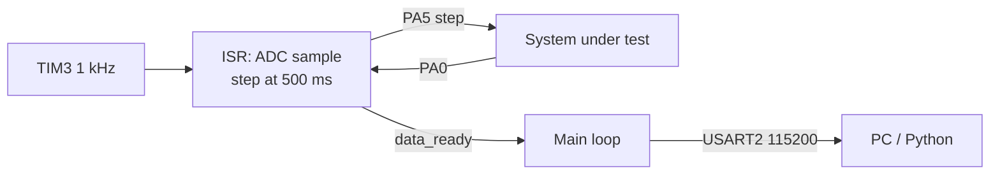

# Timer-Driven ADC Logger with Step Output


-orange)


A register-level data logger for an STM32F401 Discovery board. **TIM3** generates an interrupt every **1 ms**; each interrupt takes one **ADC** sample, and the main loop streams the samples to a PC over UART. At exactly **t = 500 ms** the firmware drives **PA5 high once**, producing a step input — so the stream captures a system's **step response** at a fixed 1 kHz sample rate.

## Features

- **TIM3 time base**: 16 MHz / 16 / 1000 → 1 kHz update interrupt
- **Sampling in the ISR**: one ADC1 conversion (channel 0, PA0) per tick, handed to the main loop with a `data_ready` flag
- **Step output**: PA5 is held low at start-up and set high at the 500th millisecond
- **Heartbeat LED** on PB0, toggled every 500 ms
- **UART streaming**: one decimal value per line at 115200 baud, easy to read from a terminal or a Python script

## Hardware

| Part | Notes |
|---|---|
| STM32F401C-DISCO | Default 16 MHz HSI clock |
| Circuit or plant under test | Driven by PA5, measured on PA0 (0–3.3 V) |
| USB–TTL serial adapter | 115200 baud, 8N1 |

### Wiring

| Signal | STM32 pin | Connects to |
|---|---|---|
| Step output (GPIO) | PA5 | Input of the system under test |
| ADC1_IN0 (analog) | PA0 | Output of the system under test |
| Heartbeat LED (GPIO) | PB0 | LED + resistor |
| USART2_TX (AF7) | PA2 | USB–TTL RX |
| GND | GND | Common ground |



Output: one ADC reading (0–4095) per line, one line per millisecond.

## Build and flash

Requires the [Arm GNU Toolchain](https://developer.arm.com/downloads/-/arm-gnu-toolchain-downloads) (`arm-none-eabi-gcc`) and GNU Make.

```bash
make            # -> build/BareMetal_Timer_ADC_UART.elf / .bin
make flash      # uses st-flash (stlink tools)
```

Or flash the `.elf` with STM32CubeProgrammer / STM32CubeIDE.

## Notes

- The `USB_HOST/` and `Middlewares/` folders and `Core/Inc/exti_driver.h` were generated by STM32CubeMX / left over from another exercise. They are not used by `main.c` and are excluded from the build.
- The ADC conversion is awaited inside the timer ISR; it takes a few microseconds, well within the 1 ms period.

---

### 🇹🇷 Türkçe özet

STM32F401 Discovery için HAL kullanmadan register düzeyinde yazılmış veri kaydedici. TIM3 her 1 ms'de bir kesme üretiyor; her kesmede ADC1 (PA0) bir örnek alıyor ve ana döngü değeri USART2 (PA2, 115200) üzerinden gönderiyor. Tam 500. milisaniyede PA5 bir kez HIGH yapılarak basamak (step) girişi veriliyor; böylece bir sistemin basamak yanıtı 1 kHz örnekleme hızıyla kaydedilebiliyor. PB0'daki LED 500 ms'de bir yanıp sönüyor.
